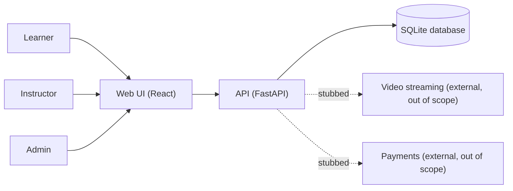
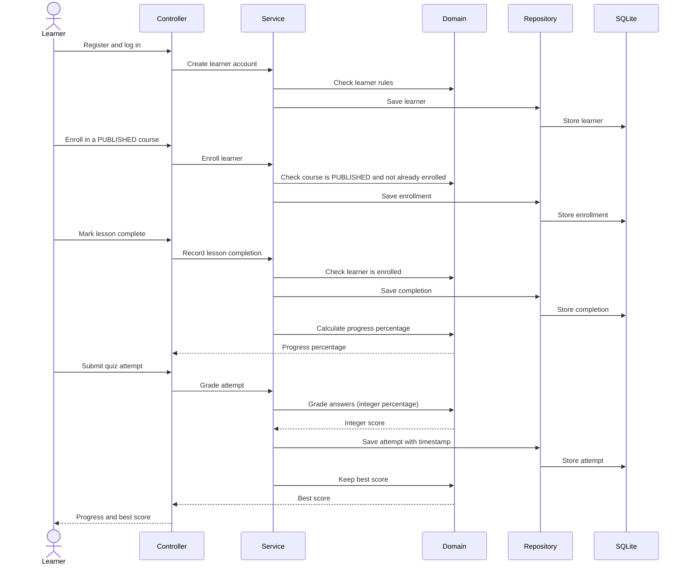

# LearnLab — Architecture

*Version 1. Updated after the harness produces the detailed design in sprint 1.*

## 1. Overview & Technology Stack

LearnLab is a lightweight learning management system. It has one backend API and one web frontend, with a single SQLite database. The backend runs one command and loads seed data.

| Part | Choice |
|---|---|
| Frontend | React with Vite and TypeScript, styled with Tailwind. The layout is responsive. Code lives in frontend/. |
| Backend | Python 3.12 with FastAPI. Code lives at the repository root in src/, with tests in tests/ and migrations in migrations/. |
| Database | SQLite, accessed through SQLAlchemy. Schema changes are made with Alembic migrations. |
| Testing | pytest for the backend, Vitest for the frontend, Playwright for end-to-end tests (e2e/). |
| Architecture checks | import-linter, with tests in tests/architecture/. |
| Coverage | pytest-cov for the backend, Vitest coverage for the frontend. |
| CI | GitHub Actions with Claude Code Action. A GitLab CI variant may be added later. |
| MCP | Playwright MCP server. |
| Required plugin | Claude Harness Engine plugin. |

## 2. Layered Structure

| Layer | Folder | Responsibility |
|---|---|---|
| controllers | src/controllers/ | Receives requests, checks the caller's role, and passes work to services. |
| services | src/services/ | Runs use cases such as enrolling, completing a lesson, or submitting a quiz. |
| repositories | src/repositories/ | Reads and writes records in the database. |
| domain | src/domain/ | Business rules with no framework code: course states, enrollment, quiz grading, progress, and access. |
| core | src/core/ | Configuration and logging, used by every layer. |

Dependencies flow one way only: controllers → services → repositories → domain. The domain does not depend on any other layer. The one-way rule is enforced by import-linter and by tests in tests/architecture/.

## 3. System Context (C4 level 1)

Video and payments are external and out of scope (out of scope list). The project stubs them.

## 4. Enrollment-to-Completion Flow

## 5. Domain Rules (src/domain/)

The capstone doc requires at least four rule, policy, or validator files under src/domain/. The planned files are below. The design step sets the final file names and the code.

| Planned rule | Purpose | Covers |
|---|---|---|
| Course state rule | Allowed lifecycle moves: DRAFT → PUBLISHED → UNPUBLISHED → ARCHIVED. Any other move raises InvalidCourseStateException. | AC-02, AC-04, AC-08, DR-1 |
| Enrollment policy | Enroll only in PUBLISHED courses, one enrollment per learner and course. | AC-01, AC-04, DR-3, DR-4 |
| Quiz grading rule | Auto-grade MCQ (single correct) and TRUE / FALSE questions with a fixed rule; score as an integer percentage. | AC-05, AC-06, NFR-01, DR-6, DR-7 |
| Progress calculation rule | Course progress as completed lessons divided by total lessons; band counts for instructors. | AC-07, AC-09, DR-5 |
| Access policy | Role separation, learners see only their own progress, instructors cannot grade their own courses' learners. | NFR-04, NFR-08, DR-10, DR-11, DR-12 |

## 6. Cross-Cutting Concerns

- **Role checks:** every request is checked for the caller's role at the controller layer (NFR-04).
- **Logs:** logs are structured JSON and carry a request correlation id (NFR-06).
- **PII masking:** learner personal data is never written to logs in plain text (NFR-03, DR-13).
- **Health check:** the health endpoint answers 200 within 1 second of startup (NFR-07).
- **Append-only records:** quiz attempts, lesson completions, and enrollments are never edited or deleted (NFR-02, DR-9).
- **Migrations:** migrations are only added, never edited (NFR-05).
- **Published courses:** a published course cannot change without an unpublish transition (NFR-08).

## 7. Detailed Design

The harness generates the detailed design in specs/design/ during sprint 1. This document is updated after that step.
